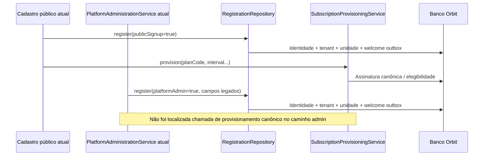

# PR-00.C — Capacidades administrativas reais do Orbit V2

Data/base e método: [estado atual](orbit-v2-current-state-audit.md). Todos os endpoints desta seção são existentes, relativos a `/api/v1`, salvo indicação explícita de proposta. A exposição efetiva pelo Nginx não foi testada.

## Três autoridades diferentes

| Autoridade | Estado atual | Limite para integração |
| --- | --- | --- |
| Owner/gestor de tenant | Implementado: usuário interno, ownership estrutural, memberships, permissões e direitos do plano | Administra a conta cliente e seus serviços HVAC; não é operador Allblue |
| Administrador global Orbit | Implementado parcialmente: `PlatformRoleAssignment`, seed explícito e `/platform-admin` | Poder amplo, sem delegação corporativa granular ou contexto de aprovador |
| Corporate Admin / Nexus | Ausente como domínio de autenticação/autorização | Não deve reaproveitar senha do owner, JWT de usuário cliente ou bypass global por string |

O cadastro de organizações adicionais do produto usa unidades (`BusinessUnit`) dentro das regras contratadas. `POST /organizations` existe, mas retorna conflito `REGISTRATION_USE_EXISTING_ACCOUNT`; **não é provisionamento remoto de tenant**. As expressões “organização Nexus”, “tenant Orbit” e “unidade cliente” não são intercambiáveis.

## Inventário de operações

`PA` na tabela significa o conjunto atual **JWT/sessão + papel `PLATFORM_ADMIN` + permissão `platform.admin`**, não uma identidade M2M. O risco NX-A01 exige corrigir a proveniência desse privilégio antes de ampliar sua utilização.

| Operação | Endpoint / serviço | Autorização atual | Efeito observado | Estado / lacunas e riscos |
| --- | --- | --- | --- | --- |
| Visão global | `GET /platform-admin/overview`; `PlatformAdministrationRepository.overview` | PA | Contagens de organizações, usuários e assinaturas | Parcial: assinaturas ativas usam `Organization.subscriptionStatus`, não ledger canônico; inadequado como receita/saúde corporativa |
| Listar tenants | `GET /platform-admin/organizations` | PA | Busca/paginação, status, owner, plano, unidades e contagens | Implementado para admin local; adaptar projeção/PII, cursor e autorização delegada |
| Detalhar tenant | `GET /platform-admin/organizations/:id` | PA | Organização e relações administrativas | Implementado; não é diagnóstico operacional de instalação nem contrato comercial consolidado |
| Criar tenant | `POST /platform-admin/tenants`; `PlatformAdministrationService.createTenant` | PA | Usuário/credencial, organização, papéis/unidade/vínculos via `RegistrationRepository`; welcome na transação se serviço disponível | Parcial: sem `SubscriptionProvisioningService.provision`; requer senha do owner no DTO; não reaproveitar diretamente no Nexus |
| Atualizar tenant | `PATCH /platform-admin/organizations/:id` | PA | `status`, `subscriptionStatus`, `currentPeriodEnd`, `planId` no registro legado; audit log | Parcial e perigoso: não chama billing/canonical subscription/Stripe; sem precondição de versão no DTO |
| Desativar/suspender tenant | Mesmo PATCH, com status `SUSPENDED` | PA | Altera flag de organização | Bloqueio operacional não garantido: NX-A02. Não há comando dedicado com motivo/prazo/efeito definido |
| Reativar tenant | Mesmo PATCH, com status `ACTIVE` | PA | Altera flag legada | Não reativa cobrança cancelada, não prova contrato vigente, não concede automaticamente direitos canônicos |
| Excluir tenant | Nenhum endpoint de administração localizado | — | Não disponível por essa API | Não construir exclusão remota genérica; retenção automática é domínio separado e destrutivo |
| Consultar usuários globais | `GET /platform-admin/users` | PA | Identidade, e-mail, status, verificação, último acesso, memberships e papéis globais selecionados | Implementado; não seleciona hash de senha nesse método; ainda contém PII e vínculos que exigem projeção por finalidade |
| Listar recursos | `GET /platform-admin/resources` | PA | Planos e módulos no banco | Implementado como leitura; não administra instalação de módulos/serviços |
| Criar/editar plano legado | `POST /plans`, `PATCH /plans/:id`; `SubscriptionPlanService` | Papel `PLATFORM_ADMIN`, sem `platform.admin` adicional | Muda registro `Plan`, capabilities/limites legados | Parcial: não cria preço Stripe nem nova versão de contrato; risco crítico de autorização NX-A01 |
| Consultar catálogo comercial | `GET /plans/catalog` | Público | Catálogo definido em código, sem credenciais Stripe | Implementado, reutilizável como projeção comercial; versionar contrato para Nexus |
| Listar planos legados | `GET /plans` | Público | Planos ativos do banco | Implementado; distinguir do catálogo congelado e do preço Stripe |
| Administrar módulos globalmente | Nenhum write controller dedicado localizado em platform administration | — | Apenas leitura de `Module` no inventário acima | Ausente para governança corporativa; não afirmar que recursos são instaláveis por essa API |
| Consultar assinatura efetiva | `GET /organizations/current/{subscription,subscription-details,entitlements,product-access}` | Sessão/superfície; subscription-details e entitlements exigem `usage.read`; gates conforme rota | Projeção atual do contrato e direitos do tenant autenticado | Implementado para tenant atual, não para corp cross-tenant; criar read model minimizado próprio |
| Consultar billing | `GET /billing/overview`, `/billing/readiness` | `usage.read`; readiness `subscription.manage` | Estado comercial/cobrança do tenant e prontidão de configuração | Implementado; readiness não é validação integral do painel Stripe |
| Contratar/pagar | `POST /billing/checkout-session` | `subscription.manage` | Checkout hospedado, tentativa persistida; ativação posterior confirmada | Implementado; nunca tratar URL/retorno do navegador como pagamento |
| Alterar plano vigente | `POST /organizations/current/subscription/change-plan` | `subscription.manage`, `expectedVersion`, confirmações aplicáveis | Serviço escolhe trial elegível, checkout/portal ou mudança futura | Implementado para owner/autorizado local; não substituir por PATCH legado |
| Cancelar recorrência | `POST /organizations/current/subscription/cancel` | `subscription.manage`, versão, aceite da política aplicável | Confirma no provedor, preserva acesso até fim do período | Implementado; consentimento e retenção tornam comando corporativo de alto impacto |
| Desfazer cancelamento agendado | `POST /organizations/current/subscription/keep` | `subscription.manage`, versão | Remove cancelamento futuro confirmado | Implementado; não ressuscita contrato já encerrado |
| Desfazer troca futura | `POST /organizations/current/subscription/cancel-scheduled-change` | `subscription.manage`, versão | Libera schedule próprio e limpa mudança pendente | Implementado; provar titularidade Stripe/contrato e resultado antes de confirmar |
| Suspensão financeira manual | Sem comando administrativo dedicado localizado | — | Estados financeiros podem mudar por reconciliação Stripe/lifecycle | Parcial: não confundir com PATCH de `Organization.status`; definir cobrança, acesso e recuperação antes de expor |
| Membros/papéis do tenant | `GET/PATCH /organizations/current/members[/…]`, `GET/POST/PATCH/DELETE /organizations/current/roles[/…]` | Permissões de organização por rota e proteções de owner | Administração local de vínculos e acesso | Implementado; não concede legitimamente papel global; proteger namespace NX-A01 |
| Conceder admin global | `backend/scripts/seed-platform-admin.ts` | Acesso operacional ao script/perfil administrativo | Cria papel global e atribuição de plataforma | Ferramenta privilegiada, não API corporativa de grants; não disponibilizar remotamente |
| Integrações do cliente | CRUD `/integrations`, `POST /integrations/:id/validate` | `integrations.read/create/update/validate/delete` + direitos do produto | Configuração e segredos cifrados por tenant, estado de validação | Implementado; não é descoberta corporativa de instalações; jamais exportar segredos ao Nexus |
| Saúde do serviço | `GET /health/live`, `GET /health/ready`, `GET /release` | Público | Processo, conectividade SQL, SHA declarado | Implementado com alcance limitado; sem frescor de worker, entrega externa ou inventário do host |
| Métricas operacionais | Módulos dashboards/analytics/usage | Tenant, `analytics.read`/`usage.read` e plano conforme rota | Contagens e indicadores de negócio local | Parcial para Nexus: faltam definição/versionamento/janela e projeção autorizada global |
| Suporte do SaaS à Allblue | Nenhum domínio corporativo equivalente localizado | — | Não implementado | Não reutilizar portal de pedidos HVAC como suporte da assinatura Orbit |
| Manutenção global | Nenhum comando administrativo dedicado localizado | — | Não implementado como política corporativa | BUILD/DEFER: janelas, allowlist de recuperação, avisos, auditoria e escopo precisam de desenho |

Fontes: E07–E13 e E16 do [índice de evidências](orbit-v2-current-state-audit.md#evidências-principais); controladores devem prevalecer sobre nomes de testes ou comentários antigos.

## Provisionamento real: diferença importante

O caminho público não prova atomicidade única entre todos esses passos; possui boundaries e recuperação próprios. O comando corporativo futuro precisa de estado persistido de provisionamento e retomada segura, sem criar identidade/tenant duplicados após timeout. Deve separar “tenant criado”, “owner convidado”, “contratação aguardando pagamento” e “produto com acesso autorizado”.

Hoje o DTO administrativo contém senha de owner e ponteiros `externalCustomerId`/`externalSubscriptionId` legados. Ele não valida por si só a relação com `BillingCustomer` e `OrganizationSubscription`. O cadastro administrativo também não passa as mesmas opções de reserva documental/aceite do cadastro público. Exceções comerciais/admin precisam ser explícitas e auditadas, nunca presumidas porque o chamador é o Nexus.

Para planos comerciais conhecidos sem assinatura canônica, o gate resolve `PENDING_PAYMENT`, independentemente de um `subscriptionStatus=ACTIVE/TRIALING` legado. Isso protege acesso, mas deixa o provisionamento administrativo incompleto. Para contratos existentes, mudar o `planId` legado não altera automaticamente o snapshot contratado.

## Leitura corporativa não deve devolver Prisma bruto

Proposta: projeções separadas para diretório, contratação, financeiro, saúde e métricas; seleção de campos por scope e tenant grant, paginação por cursor, limites e filtros explícitos. A consulta deve indicar fonte, versão e `asOf`, além de diferenciar valor observado de valor contratado/efetivo.

Dados operacionais como nome de cliente HVAC, endereço, equipamento, evidências, assinatura, relatório e conversa de atendimento ficam fora do diretório corporativo padrão. Para suporte excepcional, acesso temporário com propósito, tenant, ticket/aprovação e auditoria de leitura. Não retornar tokens, URLs assinadas de documentos, configuração cifrada ou corpo de webhook.

## Critérios para a futura administração

- Não conceder `PLATFORM_ADMIN` a usuários do Nexus como solução de integração. Exigir principal corporativo verificável, máquina distinta do operador e autorização local por intenção/tenant.
- Separar suspensão operacional de estado financeiro: interromper acesso operacional não significa cancelar débito, conceder crédito ou apagar dados. Definir quais rotas de recuperação continuam disponíveis.
- Preservar trial, período pago, prazos de adequação, confirmação de pagamento e política de retenção existentes. O comando remoto chama o serviço canônico; não escreve status como atalho.
- Solicitações de mudança comercial com cobrança, término de trial ou cancelamento exigem consentimento/aprovação aplicável, comparação de versão e recibo de efeito.
- Provisionar owner por convite/setup seguro; a senha não passa pelo Nexus. A indisponibilidade de entrega do convite não deve apagar tenant já criado nem declarar owner ativado.
- Auditar intenção, cliente M2M, operador delegado, concessão, aprovador, motivo, tenant, versão anterior/posterior e resultado. Aprovação deve vincular o hash do pedido e expirar.

Nenhum desses critérios foi implementado nesta entrega. Contratos e prioridades estão no [modelo proposto](orbit-v2-nexus-integration-contracts.md) e no [roadmap](orbit-v2-integration-roadmap.md).
