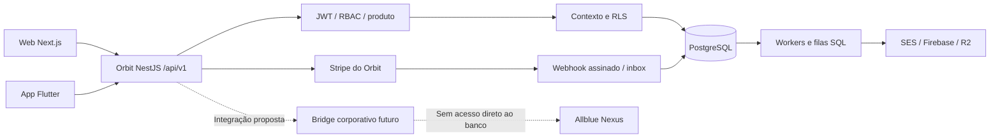

# PR-00.C — Estado real do backend Orbit V2

Data: 14/11/2026 · Base: `3a13b34f48fc271241898534186e95b8dae037f7`.
Escopo: auditoria e documentação; nenhuma implementação autorizada nesta entrega.

## Parecer

**A integração corporativa não está pronta para habilitação.** Existem bons componentes internos de billing, autorização, jobs e auditoria, mas não um protocolo Nexus. O administrador global atual também não equivale à futura identidade corporativa delegada.

Um bloqueador de segurança foi reproduzido com dependências locais reais e fixtures sintéticas: a identidade mistura nomes de papéis globais e de tenant. Um papel de tenant renomeado para `PLATFORM_ADMIN` pode alcançar a autorização por papel global e produzir o indicador de bypass de RLS sem atribuição global. Não foi executado ataque HTTP, consulta a dados de outro tenant ou teste em produção. O achado exige correção e regressão real de banco antes do lançamento; não se deve simplesmente renomear um papel e considerar o problema resolvido.

Há ainda divergência entre administração legada e assinatura canônica, suspensão administrativa sem bloqueio garantido nos gates inspecionados e reconciliação periódica Stripe sem acionamento encontrado. Esses pontos são detalhados nos relatórios associados.

| Parecer independente | Situação nesta auditoria | O que falta para aprovação |
| --- | --- | --- |
| Orbit operando sozinho | **Não aprovado por esta auditoria** | Corrigir o bloqueador de privilégio; validar suspensão/billing e concluir gates da revisão de produção existente |
| Orbit integrado ao Nexus | **Não pronto** | Identidade M2M, contratos, mapeamento, outbox/inbox corporativos, recibos e reconciliação |
| Extensão Corporate Admin | **Não implementada como domínio separado** | SSO/delegação corporativa, autorização granular, aprovações, backend dedicado e posteriormente interface |

Ausência de Nexus não impede o produto hoje: não foi encontrada dependência dele no backend. A proposta mantém essa independência.

## Estado inicial e método

| Item | Observação inicial |
| --- | --- |
| Branch | `feat/features-and-backlogs` |
| HEAD | `3a13b34f48fc271241898534186e95b8dae037f7` |
| Mensagem | `feat(email): add durable identity delivery outbox and SES preflight` |
| Data do commit | `2026-11-14T16:16:29-03:00` |
| Worktree | Limpa: `git status --short` sem saída |
| Referência local remota | `origin/feat/features-and-backlogs` no mesmo SHA; não houve fetch ou confirmação do servidor Git |

Inspeção estática de módulos, controladores, serviços, DTOs, Prisma, migrations, Compose, CI e relatórios anteriores. Verificações executadas: cinco suítes unitárias direcionadas e duas sondagens de dependências puras. Não foram abertas configurações secretas reais, consultadas contas de provedores, iniciados serviços, aplicadas migrations, executados deploys ou alterados dados. Não houve revisão do código do Nexus nem inspeção do servidor Ubuntu nesta etapa.

Vocabulário usado nos seis documentos:

| Estado da evidência | Significado |
| --- | --- |
| Implementado | Caminho concreto encontrado no checkout; não significa qualificado em produção |
| Parcial | Existe base, mas faltam efeitos, cobertura ou integração necessários |
| Documentado | Intenção/runbook/blueprint sem comprovação equivalente de execução |
| Simulado | Código ou teste explicitamente sintético; não comprova um fornecedor real |
| Ausente no escopo | Não localizado nas fontes e pontos de registro inspecionados |
| Desconhecido | Depende de ambiente, painel externo, dados ou código fora do escopo |

KEEP / ADAPT / BUILD / DEFER / UNKNOWN são decisões de reutilização, não estados de implantação; a matriz está na [análise de lacunas](orbit-v2-integration-gap-analysis.md).

## Arquitetura encontrada

Monólito modular NestJS, API HTTP, workers no mesmo projeto e filas persistidas no PostgreSQL. Web Next.js e mobile Flutter consomem a API do produto. Há **38 arquivos `*.module.ts` em `backend/src/modules`, 142 modelos Prisma e 115 diretórios de migration** nesta base. A geração comercial é Orbit V2; a API versionada efetiva continua sendo **`/api/v1`**, não `/api/v2`.

| Camada | Evidência / responsabilidade |
| --- | --- |
| Composição | `backend/src/app.module.ts`: identidade, organizações, planos, billing, operações, PMOC, RVT, documentos, financeiro operacional, notificações, automações, jobs, portal e analytics |
| HTTP | DTOs `class-validator`/`class-transformer`; bootstrap com validação e captura do corpo original de webhook; envelope de resposta, request ID e classificação de erros |
| Persistência | Prisma + PostgreSQL; `Organization` delimita tenant, `BusinessUnit` delimita unidade; relacionamentos e políticas distribuídos em migrations |
| Segurança | Sessões persistidas, JWT, RBAC, superfícies WEB/MOBILE/API, direitos de produto, RLS e contexto assíncrono por requisição/job |
| Assinaturas | `OrganizationSubscription` + snapshots/versionamento; campos antigos de `Organization` ainda coexistem |
| Integrações externas | Stripe, SES, Firebase Admin, R2 e integrações configuráveis por tenant; não há adaptador corporativo Nexus localizado |
| Assíncrono | `BackgroundJob`, `DomainEvent`, inbox Stripe e outboxes específicas; nenhum broker externo exigido pela composição inspecionada |
| Implantação declarada | Imagens Docker, API/frontend publicados em loopback, banco na rede interna, runtime e migrator separados; não foi validado o estado efetivo do host |

Versões instaladas segundo `backend/package-lock.json`: Nest core **11.2.3**, platform-express **11.2.9**, Prisma client **7.9.1**, Stripe **22.6.1**, SESv2 SDK **3.1165.0**, Firebase Admin **14.5.1**. Docker usa Node 22; Compose fixa PostgreSQL **17.11-alpine3.24** por digest. São observações do lock/configuração, não uma nova avaliação de CVEs ou garantia de versões correntes nos servidores.

Na consulta documental desta auditoria, as [notas oficiais PostgreSQL 17.12](https://www.postgresql.org/docs/release/17.12/) informam publicação em 12/11/2026, posterior ao patch fixado no Compose. Revisar atualização, aplicabilidade das correções e recomendações de manutenção no gate de infraestrutura/release; não foi diagnosticada corrupção ou exploração no banco Orbit, e nenhuma imagem/instalação foi alterada.



## Identidade, autorização e isolamento

O modelo atual contém usuários internos, credenciais, sessões, memberships de organização/unidade e `PlatformRoleAssignment`. O owner é uma relação estrutural (`Organization.ownerUserId`), não apenas um nome de papel. A identidade de cliente do portal é separada; ver [ADR-005](../../adr/ADR-005-customer-portal-identity-boundary.md). Não confundir esse cliente HVAC com a parte contratante corporativa do Nexus.

O pipeline global atual possui **nove guards**, na ordem registrada em `AppModule`: JWT, superfície, permissão, papel, plano ativo, plano requerido, capability legada, capability de produto e feature de produto. O JWT guard verifica sessão e usuário no servidor e recalcula RBAC. A resolução escolhe o primeiro membership ativo; isso não constitui seleção arbitrária de tenant para um operador corporativo.

RLS usa `set_config(..., true)` dentro da transação e `AsyncLocalStorage` para organização, unidades, usuário, papéis e permissões. `PrismaService` verifica que a conexão de runtime não possui `SUPERUSER`/`BYPASSRLS`. Workers reconstituem contexto de tenant. Há exceções de bootstrap de identidade e rotinas sistêmicas privilegiadas; **não há comprovação de FORCE RLS uniforme em todos os 142 modelos**. Nem o número de policies nem a existência de RLS substituem a verificação da proveniência do contexto.

### NX-A01 — Colisão entre papel de tenant e privilégio global — P0

Evidências encadeadas:

1. `OrganizationService.createRole`, `updateRole` e `roleKey` permitem derivar `PLATFORM_ADMIN` de um nome personalizado; não foi encontrada reserva desse namespace no fluxo ou nas migrations inspecionadas.
2. A unicidade do papel é por organização. O trigger de atribuição global exige papel sem organização, mas só protege `platform_role_assignments`, não impede a chave homônima no tenant.
3. `toAuthenticatedIdentity` junta `platformRoleAssignments.role.key` e `organizationMembership.role.key` no mesmo conjunto de strings.
4. `JwtAuthenticationGuard` só chama `hasActivePlatformRole` se a **claim antiga** já contém `PLATFORM_ADMIN`. Um token emitido antes de renomear o papel continua sem essa claim; a identidade recalculada ganha o papel global homônimo. `OrganizationRepository.updateRole` não revoga sessões nesse caminho.
5. `RoleGuard` aceita o nome e `RlsContextProvider` traduz sua presença diretamente para `app.is_platform_admin=true`. Algumas policies permitem acesso pela flag de plataforma.
6. `POST /plans` e `PATCH /plans/:id` exigem esse papel, sem permissão corporativa adicional. `/platform-admin` exige também `platform.admin`: a sondagem **não demonstra** acesso de um não owner a esse controlador completo.

Pré-condições: alguém autorizado a administrar papéis do tenant, um membro vinculado a papel personalizado, sessão válida emitida anteriormente, superfície permitida e renomeação desse papel. Não é prova de escalada sem autenticação nem de leitura efetiva de dados de terceiros. Filtros de repositório podem restringir consultas específicas; a autorização e o bypass RLS derivados da origem errada continuam sendo um bloqueador crítico.

Correção proposta, não aplicada: proveniência explícita e verificada para privilégios globais, namespace reservado na aplicação/banco, revalidação do grant atual e regressões de HTTP/PostgreSQL com runtime restrito. Uma futura claim corporativa não deve ser convertida genericamente em bypass global de RLS.

### NX-A02 — Suspensão administrativa sem efeito de bloqueio garantido — P1

`PlatformAdministrationRepository.updateOrganization` pode gravar `Organization.status=SUSPENDED`. `SubscriptionPlanService.getEntitlements/grantsAccess` considera a assinatura e não esse status. O JWT guard inspecionado verifica o status do usuário, não o da organização; as policies de isolamento citadas não são um gate de suspensão.

A sondagem local com organização SUSPENDED e contrato canônico ACTIVE retornou acesso pelo gate de plano. Não prova que todo endpoint permite qualquer ação: comprova que esse gate não implementa a suspensão administrativa. Suspensão operacional, inadimplência, cancelamento futuro e expiração precisam ter semânticas distintas e caminhos de recuperação explícitos.

## Contratos, observabilidade e assíncrono

Decorators Swagger e DTOs existem, assim como verificações de read models entre backend/web. A busca por `SwaggerModule.createDocument`, `SwaggerModule.setup` e `DocumentBuilder` não localizou publicação runtime de OpenAPI. Não há OpenAPI/AsyncAPI corporativo versionado ou testes de consumidor Nexus localizados. Os DTOs internos não devem ser exportados automaticamente como protocolo público de administração.

`DomainEventEmitter.emit(tx, input)` persiste o fato e o job de automação na transação recebida, com correlação e payload escalar mínimo. O catálogo é fechado e **descarta nomes desconhecidos**. Eventos de tenant, assinatura e cobrança corporativa propostos nesta auditoria ainda não estão nesse catálogo. A fila atual espera escopo de unidades válido; um evento global sem unidades não pode ser ligado ao worker existente sem adaptação. `DomainEvent` é apagável por cascade da organização, portanto não é um arquivo corporativo permanente.

Existem logs estruturados por request ID/duração, erros sanitizados e métricas emitidas em logs de alguns workers. `AuditLog` tem ator local, antes/depois e metadata; não possui identidade delegada estruturada, aprovador, mandato, política e recibo corporativo. Não foi comprovada proteção geral de imutabilidade dessa trilha. A auditoria de alteração administrativa é parcial e nem toda leitura administrativa gera registro.

`GET /health/live` indica processo vivo; `GET /health/ready` executa `SELECT 1`. Não verifica idade de filas, DLQ, entregabilidade SES, FCM, Stripe ou disponibilidade do Nexus. Não deve ser apresentado no Nexus como diagnóstico completo de instalação. Um eventual bridge indisponível deve afetar apenas sua própria saúde, não derrubar a prontidão operacional do Orbit.

## Verificações executadas nesta etapa

Comando executado em `backend/`, sem serviços externos:

```sh
./node_modules/.bin/jest --runInBand --watchman=false --testPathPatterns='platform-administration.service|billing-reconciliation.service|stripe-billing.provider|foundation.guards|authorization.service'
```

Resultado: **5 suítes, 40 testes aprovados**, 2,866 segundos. São testes unitários, com dependências simuladas onde aplicável. Entre os casos: criação administrativa pelo boundary compartilhado; plano inexistente; segredo incorreto de webhook; bytes originais do webhook; preço antes do checkout; schedule vinculado; evento antigo de outra contratação; backoff/DLQ e normalização de fatura/estorno. O nome do teste administrativo menciona provisionamento, mas o mock não prova criação de assinatura canônica no banco.

Duas sondagens adicionais executaram classes reais via `ts-node`, com repositórios/tokens/contextos sintéticos, sem banco, HTTP ou fornecedor:

```json
{
  "tenantRoleCollision": {
    "oldTokenRole": "CUSTOM_TEAM",
    "freshTenantRole": "PLATFORM_ADMIN",
    "globalAssignments": 0,
    "authenticated": true,
    "assignmentChecks": 0,
    "roleOnlyEndpointAccepted": true,
    "rlsPlatformFlag": "true"
  },
  "organizationSuspension": {
    "organizationStatus": "SUSPENDED",
    "canonicalSubscriptionStatus": "ACTIVE",
    "resolvedSubscriptionStatus": "ACTIVE",
    "planGateGrantsAccess": true
  }
}
```

Reprodução conceitual verificável: chamar `JwtAuthenticationGuard.canActivate` com sessão WEB válida, claim `CUSTOM_TEAM`, membership atualizado `PLATFORM_ADMIN`, zero grants globais e `hasActivePlatformRole=false`; passar a identidade resultante ao `RoleGuard` e `RlsContextProvider`. Separadamente, resolver `getEntitlements/grantsAccess` com organização suspensa e assinatura ACTIVE não vencida. As sondagens não criam papel, validam assinatura JWT criptográfica ou exercitam policies reais; essas etapas foram examinadas estaticamente e exigem regressão integrada posterior.

Relatórios históricos de CI/local estão em [PR-03](../../release/pr-03-baseline-ci.md) a [PR-07](../../release/pr-07-ses-durable-delivery.md). Não foram repetidas suítes completas, builds, scans de dependências ou E2E de banco nesta auditoria. Não houve acesso ao CI remoto. O histórico verde não cobre automaticamente os novos achados.

Validação documental: seis relatórios, quatro blocos JSON parseados e referências locais existentes. As únicas inclusões no worktree são estes documentos; o HEAD e os arquivos de aplicação foram preservados.

## Evidências principais

As linhas se referem ao SHA-base; símbolos são a referência estável quando a numeração mudar.

| ID | Fonte e símbolo | Constatação |
| --- | --- | --- |
| E01 | [AppModule](../../../backend/src/app.module.ts), [main](../../../backend/src/main.ts), [AppService](../../../backend/src/app.service.ts) | Composição, guards, bootstrap, saúde limitada ao banco |
| E02 | [Schema Prisma](../../../backend/prisma/schema.prisma#L294), `Organization`, `BusinessUnit`, `OrganizationMembership`, `Role`, `PlatformRoleAssignment` | Tenant/unidade, papéis e atribuição global |
| E03 | [toAuthenticatedIdentity](../../../backend/src/modules/identity/application/authentication.service.ts#L32), [JwtAuthenticationGuard](../../../backend/src/modules/identity/infrastructure/jwt-authentication.guard.ts#L78) | União de papéis; checagem de grant condicionada à claim antiga |
| E04 | [OrganizationService](../../../backend/src/modules/organizations/organization.service.ts#L259), `createRole/updateRole/roleKey`; [repository](../../../backend/src/modules/organizations/organization.repository.ts#L446) | Chave personalizada e atualização sem revogar sessões nesse caminho |
| E05 | [RlsContextProvider](../../../backend/src/database/rls/rls-context.provider.ts#L33), [RlsTransaction](../../../backend/src/database/rls/rls-transaction.ts), [PrismaService](../../../backend/src/database/prisma.service.ts#L94), [interceptors](../../../backend/src/interceptors/foundation.interceptors.ts#L54) | Propagação de papéis, flag privilegiada e contexto transacional |
| E06 | [Migration de administração](../../../backend/prisma/migrations/20260731170000_platform_administration/migration.sql#L49), `enforce_global_platform_role`; [RoleGuard](../../../backend/src/guards/foundation.guards.ts) | Restrição só na atribuição global; autorização por string |
| E07 | [Admin controller](../../../backend/src/modules/platform-administration/platform-administration.controller.ts#L31), [service](../../../backend/src/modules/platform-administration/platform-administration.service.ts#L52), [repository](../../../backend/src/modules/platform-administration/platform-administration.repository.ts#L164), [DTO](../../../backend/src/modules/platform-administration/dto/platform-administration.dto.ts) | Administração existente e efeitos legados |
| E08 | [SubscriptionPlanService](../../../backend/src/modules/subscription-plans/subscription-plan.service.ts#L71), [controller](../../../backend/src/modules/subscription-plans/subscription-plan.controller.ts#L51), [EntitlementService](../../../backend/src/modules/subscription-plans/entitlements/entitlement.service.ts) | Gates, escrita de planos e assinatura canônica |
| E09 | [RegistrationService](../../../backend/src/modules/identity/application/registration.service.ts#L64), [SubscriptionProvisioningService](../../../backend/src/modules/subscription-plans/subscriptions/subscription-provisioning.service.ts), [ADR-007](../../adr/ADR-007-subscription-is-the-entitlement-authority.md) | Cadastro público provisiona assinatura; autoridade de direitos |
| E10 | [BillingConfig](../../../backend/src/modules/billing/billing.config.ts#L37), [StripeBillingProvider](../../../backend/src/modules/billing/stripe/stripe-billing.provider.ts) | Uma configuração Stripe, preços, SDK e comandos |
| E11 | [BillingService](../../../backend/src/modules/billing/billing.service.ts), [SubscriptionService](../../../backend/src/modules/subscription-plans/subscriptions/subscription.service.ts) | Checkout, mudanças, cancelamento e CAS |
| E12 | [Webhook service](../../../backend/src/modules/billing/billing-webhook.service.ts), [reconciliation](../../../backend/src/modules/billing/billing-reconciliation.service.ts#L277), [worker](../../../backend/src/modules/billing/billing-event.worker.ts#L54) | Inbox, releitura canônica; sweep sem call site localizado |
| E13 | [BillingRepository](../../../backend/src/modules/billing/billing.repository.ts#L346), [schema de faturas](../../../backend/prisma/schema.prisma#L934) | Ledger, transições, ajustes, unicidade e escopo |
| E14 | [DomainEventEmitter](../../../backend/src/modules/automations/domain-event.emitter.ts), [catálogo](../../../backend/src/modules/automations/automation.catalog.ts), [BackgroundJobWorker](../../../backend/src/modules/jobs/background-job.worker.ts), [queue](../../../backend/src/modules/jobs/background-job.queue.ts) | Outbox de automações e fila SQL, não bridge corporativo |
| E15 | [AuditLog](../../../backend/prisma/schema.prisma#L3030), [DomainEvent](../../../backend/prisma/schema.prisma#L4013), [contract manifest](../../orbit-contracts-manifest.md) | Auditoria genérica e contratos internos |
| E16 | [Integrações](../../../backend/src/modules/integrations/integration.controller.ts), [solicitações de serviço](../../../backend/src/modules/customer-service-requests/customer-service-request.controller.ts), [analytics](../../../backend/src/modules/analytics/analytics.service.ts) | Domínios operacionais distintos de governança corporativa |
| E17 | [Compose](../../../docker-compose.yml), [CI](../../../.github/workflows/ci.yml), [plano de produção](../../release/production-pr-plan-2026-11-12.md) | Infra declarada, gates e correções anteriores |
| E18 | [Admin unit tests](../../../backend/src/modules/platform-administration/platform-administration.service.spec.ts), [reconciliation tests](../../../backend/src/modules/billing/billing-reconciliation.service.spec.ts), [provider tests](../../../backend/src/modules/billing/stripe/stripe-billing.provider.spec.ts), [guard tests](../../../backend/src/guards/foundation.guards.spec.ts), [authorization tests](../../../backend/src/common/authorization.service.spec.ts) | As cinco suítes executadas |
| E19 | [Lifecycle worker](../../../backend/src/modules/subscription-plans/subscriptions/subscription-lifecycle.worker.ts), [limit adjustment](../../../backend/src/modules/subscription-plans/entitlements/limit-adjustment.ts), [retention service](../../../backend/src/modules/billing/retention/subscription-data-retention.service.ts) | Relógio local, 48h de adequação e exclusão futura condicionada |

## Limitações e próximos documentos

Não há atestado de isolamento completo, carga, integridade de dados existentes, entrega de push/e-mail, configuração efetiva Stripe, restauração de backup ou estado de APNs. A saúde real e os dados de produção permanecem desconhecidos. Código de billing implementado não comprova contas/preços/webhooks ativos. A lista de riscos de produção anterior continua válida como backlog, devendo ser conciliada com commits posteriores antes do gate final.

- [Capacidades administrativas](orbit-v2-admin-capabilities.md).
- [Stripe e billing](orbit-v2-stripe-and-billing-audit.md).
- [Contratos propostos](orbit-v2-nexus-integration-contracts.md).
- [Lacunas e readiness](orbit-v2-integration-gap-analysis.md).
- [Roadmap de PRs](orbit-v2-integration-roadmap.md).
