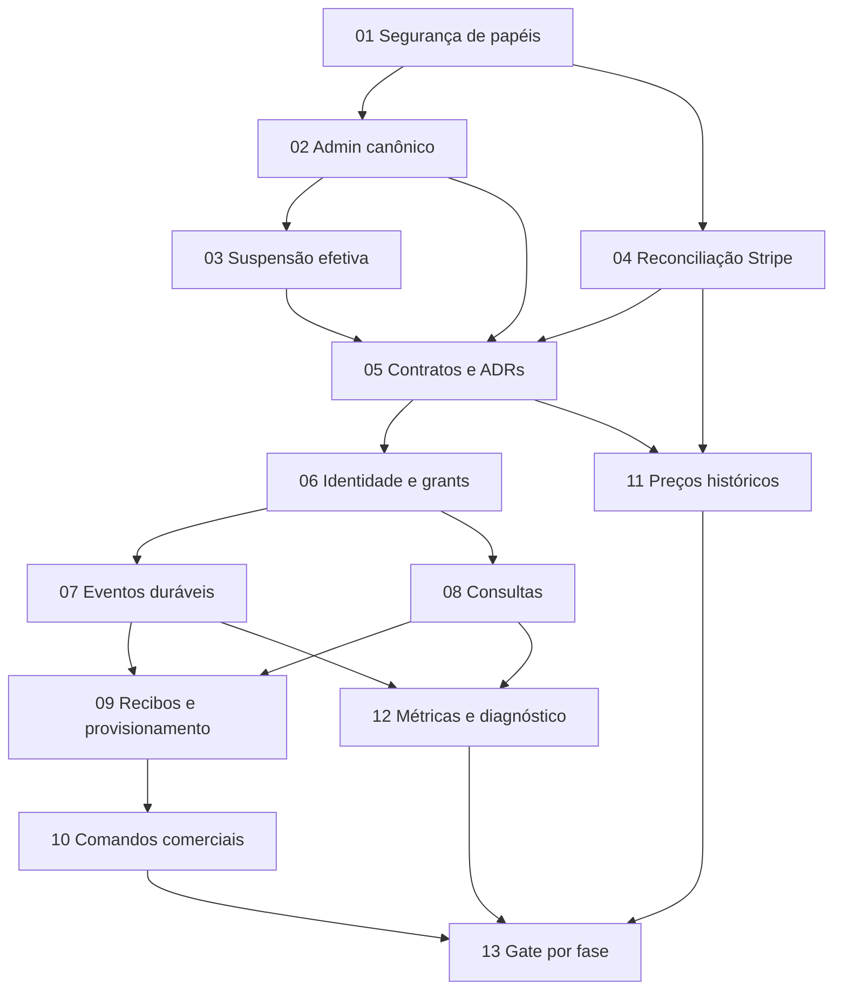

# PR-00.C — Roadmap proposto do lado Orbit V2

Base: `3a13b34f48fc271241898534186e95b8dae037f7`, 14/11/2026. **Planejamento, sem implementação, commit, push, merge ou deploy nesta entrega.** A execução de qualquer item requer autorização posterior. Manter PRs pequenas e sequenciais, com evidência no SHA final.

Prefixo **ORB-NX** evita colisão com a sequência de correções de produção PR-01…19, atualmente documentada em [production-pr-plan](../../release/production-pr-plan-2026-11-12.md). Este roadmap não renumera ou dá como concluídas essas PRs. PR-08 de produção continua sendo SNS/supressão, e não um item corporativo deste documento.

## Ordem e dependências

| PR proposta | Prioridade / objetivo | Depende de | Gate que habilita |
| --- | --- | --- | --- |
| ORB-NX-01 | **P0** · Proveniência de administrador global e namespace de papéis | — | Segurança básica do produto; nenhuma integração antes dela |
| ORB-NX-02 | **P1** · Administração e provisionamento com contrato canônico | 01 | Fonte administrativa coerente, não concessão financeira remota |
| ORB-NX-03 | **P1** · Política efetiva de suspensão/reativação operacional | 01, 02 | Controle de acesso com semântica verificável |
| ORB-NX-04 | **P1** · Sweep Stripe e replay financeiro real | 01 | Recuperação de cobrança; base de fatos confiáveis |
| ORB-NX-05 | **P1** · ADRs e contratos corporativos versionados | 02, 03, 04 + decisões Nexus | Interface estável acordada, ainda sem exposição |
| ORB-NX-06 | **P1** · Trust M2M, delegação, mapeamento e auditoria | 01, 05 + IdP/grants Nexus | Boundary corporativo autenticado e autorizado |
| ORB-NX-07 | **P1** · Outbox/exporter corporativo e ressincronização | 04, 05, 06 + inbox Nexus | Eventos duráveis; sem comandos comerciais |
| ORB-NX-08 | **P1** · Consultas administrativas minimizadas | 02, 03, 05, 06 | Diretório/status/assinatura/financeiro somente leitura |
| ORB-NX-09 | **P1** · Inbox/recibos e provisionamento governado | 02, 03, 06, 07, 08 | Primeiro comando de escrita restrito por allowlist |
| ORB-NX-10 | **P1** · Solicitações comerciais com confirmação Orbit | 04, 09 + política de aprovação/consentimento | Mudança/cancelamento/keep autorizados; preços remotos continuam fechados |
| ORB-NX-11 | **P1 para trocar preços / P2 expansão** · Registry histórico e governança de preços | 04, 05; 06/10 para futura escrita corporativa | Preços versionados; comando remoto não é habilitado automaticamente |
| ORB-NX-12 | **P2** · Métricas, diagnóstico e limites de suporte | 05, 06, 07, 08 + definições Nexus | Informações corporativas confiáveis, sem dados HVAC individuais por padrão |
| ORB-NX-13 | **Gate** · Resiliência, qualificação e rollout | Todos os itens habilitados + gates independentes de produção | Aceite formal por fase, com rollback/kill switch |

Numeração define uma sequência de revisão; dependências indicam também o encadeamento lógico. Não implementar os treze itens de uma vez. Registry histórico deve ser antecipado se houver necessidade de alterar Price IDs antes da fase corporativa. Preço remoto, refund, exclusão e suporte intrusivo podem permanecer **DEFER** sem impedir leitura/eventos.

## Escopo e aceite de cada PR

### ORB-NX-01 — Eliminar confiança em nome de papel para privilégio global

Tratar NX-A01: separar papéis de tenant, grants globais e futuros grants corporativos na identidade/contexto. Reservar chaves protegidas em create/update e persistência; validar grant global atual independentemente de claims antigas. Revisar todos os consumidores de `roles.includes('PLATFORM_ADMIN')`, não apenas `/platform-admin`. Manter a propriedade estrutural do owner sem conceder poder de plataforma.

Aceite: testes de HTTP e PostgreSQL restrito demonstram que criar/renomear papel e reutilizar sessão antiga não concede endpoint de plano global nem flag RLS; múltiplos tenants e unidades; grant global legítimo/revogado e owner seguem corretos. Validar dados legados antes de qualquer correção automatizada. Não apagar papéis ou vínculos como atalho.

### ORB-NX-02 — Alinhar administração com a assinatura canônica

Tratar NX-A03: separar configuração não financeira de intenções comerciais, eliminar alteração de estado financeiro efetivo por PATCH legado e compor provisionamento com assinatura canônica, elegibilidade, owner setup e retomada idempotente. Corrigir overview/projeções para não contar status legado como contratação ativa. Preservar compatibilidade de consumidores locais com migração explícita de contrato.

Aceite: criar tenant em plano pago não concede acesso sem pagamento; Essencial só recebe trial se elegível; falha após criar identidade/tenant é retomável sem duplicação. Alterar plano administrativo passa pelo domínio canônico; owner não precisa entregar senha ao Nexus. Regressão de campos financeiros antigos e auditoria completa das mudanças permitidas. Divergências de dados existentes exigem relatório read-only e plano aprovado, não reparo presumido.

### ORB-NX-03 — Definir suspensão operacional de verdade

Tratar NX-A02: serviço de suspensão/reativação com motivo, validade, autoridade e versão. Decidir gates para web/mobile/jobs e rotas de recuperação; não confundir suspensão de acesso com inadimplência, cancelamento Stripe ou exclusão de dados. Não congelar cobrança ou destruir dados por implicação.

Aceite: tenant SUSPENDED com assinatura ACTIVE tem as ações operacionais previstas bloqueadas nas três superfícies; conta de recuperação/billing segue política explícita. Reativar não concede plano pago inexistente. Jobs pendentes e requisições concorrentes obedecem a política sem acessar outro tenant; eventos só expressam efeito aplicado.

### ORB-NX-04 — Acionar recuperação Stripe e provar replay

Tratar NX-A04/NX-A06: agendar sweep de assinaturas vinculadas, bounded por lote/tempo e coordenado entre réplicas; separar relógio local de estado externo. Rever replay de invoice/transition com PostgreSQL real, corrida de criação, lease/fencing e correlação com a contratação corrente. Definir recuperação de invoices/ajustes perdidos além do snapshot da assinatura. Distinguir fatura liquidada de pagamento efetivamente correlacionado antes de habilitar eventos corporativos de caixa.

Aceite: webhook perdido converge; duplicatas/out-of-order/crash e P2002 não deixam transação abortada ou falso sucesso; eventos antigos não alteram nova compra. Sem dupla cobrança e sem ACTIVE antes da confirmação exigida. Retry/DLQ recuperáveis, ownership e versão validados, métricas de atraso e runbook. Usar fixtures/sandbox isolada com autorização posterior para qualquer teste externo.

### ORB-NX-05 — Formalizar o protocolo federado

Partir de [contratos propostos](orbit-v2-nexus-integration-contracts.md), revisar com Nexus e registrar ADRs: autoridade, namespaces, IDs, evento/command/receipt, errors, status agendado versus aplicado, compatibilidade e minimização. Gerar schemas/contratos revisáveis e testes de consumidor, sem exportar DTOs Prisma/admin bruto.

Aceite: JSON Schema/OpenAPI e exemplos sintéticos validam requests/responses; eventos têm origem/ID/versão/tempo/sequence; alteração incompatível falha no CI. Documentar dado proibido, política de replay/catch-up, limites e estados pendentes. Nenhum endpoint produtivo ativado só por publicar documentação.

### ORB-NX-06 — Construir a fronteira corporativa

Tratar NX-A07/NX-A10/NX-A15: trust registry por produto/ambiente/instalação, OAuth M2M e operador delegado verificável; grants locais limitados por ação/tenant/purpose; mapping party/tenant/contrato sem igualdade de IDs. Preparar OIDC para futura extensão administrativa em boundary próprio, sem iniciar frontend.

Aceite: issuer/audience/algoritmo/chave expirados ou incorretos, tenant divergente, token de cliente e actor forjado são recusados. Rotação/revogação e step-up testados; scope não dá autorização global implícita; replay rejeitado. Auditoria distingue máquina/operador/aprovador e não armazena tokens. Nenhuma credencial corporativa compartilhada com produtos futuros.

### ORB-NX-07 — Publicar fatos sem acoplar operação ao Nexus

Tratar NX-A08/NX-A16: outbox corporativa ligada ao commit do domínio, worker com orçamento próprio, retries/DLQ, assinatura e ACK durável. Criar dedupe por fato/versão e mecanismos de snapshot/cursor/catch-up. Reusar infraestrutura SQL somente após adequar escopo global/organizacional e limites; export não depende de automação premium do tenant.

Aceite: crash em cada fronteira, ACK perdido, duplicação, reordenação e Nexus indisponível por período prolongado não perdem fato ou repetem efeito. Login/atendimento/PDF/cobrança não esperam Nexus; backlog não esgota disco/pool. Validação dos schemas, política de retenção, replay auditado, event lag e worker isolado demonstrados em teste controlado.

### ORB-NX-08 — Oferecer consultas sem expor domínio inteiro

Projetar diretório paginado e read models separados de assinatura, financeiro, uso básico e estado operacional; filtros por grant e dados minimizados, `asOf` e frescor. Consertar métricas administrativas legadas antes de exportá-las. Não retornar raw `Organization`/usuários ou segredos de integrações.

Aceite: clientes/tenants/unidades sem autorização não aparecem nem são enumeráveis; paginação/cursor e limites funcionam em volume; PII/URLs sensíveis ausentes dos contratos gerais; reads corporativos auditados. Comparar snapshot com fonte canônica no mesmo watermark. API permanece útil e autenticada mesmo sem tela Corporate Admin.

### ORB-NX-09 — Persistir intenções e recibos

Tratar NX-A09: inbox de comandos e state machine com identidade/hash/idempotência, CAS, aprovação/expiração, lease e consulta do resultado. Primeiro habilitar apenas provisionamento aprovado ou ação não financeira de baixo alcance definida em allowlist. Invocar serviços do produto, sem escrita direta em tabelas de domínio.

Aceite: repetir comando após timeout devolve recibo original; payload diferente com mesma chave é conflito; worker duplicado não duplica tenant. Grant revogado/approval expirado não executa; falha parcial é retomável. Resultado confirmado está vinculado à versão/efeito aplicado; 202 não aparece como concluído no consumidor.

### ORB-NX-10 — Solicitar mudanças comerciais preservando consentimento

Integrar receipt com `BillingService` para alteração de plano, cancelamento futuro e keep onde autorizado; preservar período pago, elegibilidade de trial, confirmações e fluxo hospedado de pagamento. O Nexus não emite comandos de cobrança direta, concede dias grátis ou seta status. Estado `AWAITING_CUSTOMER_ACTION` e agendamento precisam de UX/contrato explícitos.

Aceite: trial elegível/ineligível, término de trial consentido, upgrade/downgrade no fim do período pago, 48h de adequação e cancelamento/retorno seguem as regras locais. Assinatura/price de outro produto/tenant é recusado. Sem sucesso por redirect ou resposta otimista; recibo registra agendamento sem antecipar vigência/limites. Testar mudança concorrente do owner com solicitação corporativa.

### ORB-NX-11 — Preservar versões financeiras

Tratar NX-A05: registry de preços por plano/intervalo/catálogo/conta/modo, imutável quanto a contratos passados. Política de publicação e aprovações, rollback por nova versão e observabilidade de preço desconhecido. **Não habilitar criação remota de preço nesta PR por inferência**; isso exige autorização e contrato próprios depois da governança.

Aceite: contrato antigo reconcilia após nova versão, webhook atrasado usa versão correta e nunca escolhe preço por aproximação. Mudança de catálogo não reescreve histórico nem altera plano de clientes sem fluxo autorizado. Fixtures de múltiplas contas/modos não se misturam. Refund/exclusão/crédito continuam fora do CRUD corporativo genérico.

### ORB-NX-12 — Métricas e diagnóstico por finalidade

Tratar NX-A11 e delimitar NX-A12: métricas agregadas com janela/definição/versão/frescor, estado de workers/providers sem segredos, latência/erros/idade de DLQ e referências de release. Separar financeiro SaaS de faturamento HVAC; excluir painéis explicitamente simulados. Suporte corporativo requer decisão de domínio anterior, não conversão automática de pedidos do portal.

Aceite: totais reconciliam com fonte/definição, período civil/fuso e moeda; limites de custo, paginação e acesso; indicador desconhecido não é saudável. Não carregar evidências/documentos de cliente por padrão. Nenhuma indisponibilidade de Nexus degrada readiness operacional do Orbit. Se tickets corporativos continuarem DEFER, não publicar seus eventos como disponíveis.

### ORB-NX-13 — Qualificar e liberar por fases

Medir cenários de carga/falha, restauração e replay no SHA de release; threat model de confiança/delegação, revisão de diffs, auditoria de dependências atual e evidência de isolamento real. Conciliar gates do produto com a [PR-19 de produção](../../release/production-pr-plan-2026-11-12.md), mantendo aceites SES/FCM/APNs separados e revisando patches de infraestrutura, incluindo a diferença PostgreSQL 17.11/17.12 identificada na auditoria.

Rollout proposto: conector desligado → staging sintético → projeções/eventos em shadow → leitura corporativa limitada → provisionamento controlado → comandos comerciais autorizados. Kill switch interrompe tráfego corporativo sem remover dados ou parar o produto. Rollback preserva recibos/outbox/cursors; não desfaz efeitos financeiros confirmados sem intenção governada.

Aceite: nenhum acesso cross-tenant, alteração financeira sem confirmação, sucesso falso ou operação dependente do Nexus; SLO de lag/capacidade definido e medido; dashboards/alarmes/runbook/replay/restore exercitados. Só habilitar operações aprovadas; itens DEFER permanecem fechados.

## Decisões bloqueantes fora do Orbit

| Decisão Nexus | Bloqueia | Critério para encerrar pendência |
| --- | --- | --- |
| IdP, issuer/audience, delegação, revogação e MFA | 05/06/09 e Corporate Admin | ADR e fixtures de tokens/grants, sem chaves privadas no repositório |
| Party, produto, instância, contrato e cardinalidade | 05/06/08/09 | Identificadores e processo de vínculo/transferência aprovados |
| Inbox, ACK, dedupe/retention, cursor/snapshot e SLO | 05/07/13 | Contrato de consumidor e teste de crash/reentrega |
| Aprovação comercial e consentimento do cliente | 09/10 | Matriz de autoridade, validade e prova vinculada à intenção |
| Receita, uso e suporte consolidado | 08/12 | Definição de cada métrica e propósito de dados, sem mistura de domínios |
| UX de pedido aceito/agendado/pendente/recusado | 09/10/13 | Consumidor não apresenta SUCCEEDED como plano já vigente quando efeito é futuro |
| Política de preço remoto e ações destrutivas | 11 e expansão futura | Governança específica; até lá continuam não expostas |

## Resultado desta etapa

Foram produzidos seis relatórios documentais com evidências e propostas, não PRs implementadas. O primeiro trabalho sugerido é **ORB-NX-01**, pela falha de proveniência de privilégio. O pipeline anterior de correções de produção deve ser retomado conscientemente com essa prioridade nova, sem confundir a auditoria corporativa com autorização para alterar o sistema.
