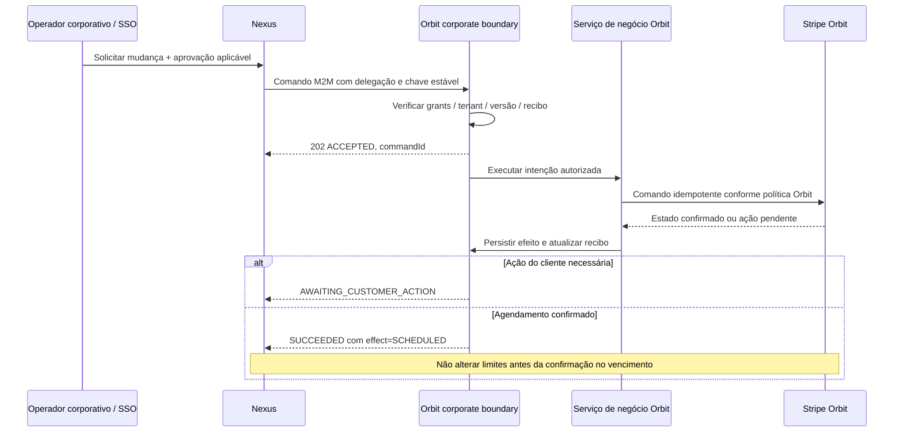

# PR-00.C — Contratos propostos para integração Orbit ↔ Nexus

**Todo endpoint, scope, envelope e modelo corporativo deste documento é PROPOSTO, não implementado.** Exemplos usam identificadores fictícios. Base e evidências do que existe: [auditoria](orbit-v2-current-state-audit.md). A aprovação deste desenho também não autoriza sua implementação.

## Fronteiras de responsabilidade

| Domínio | Autoridade | O que o outro sistema pode fazer |
| --- | --- | --- |
| Tenant, unidades, operações, direitos efetivos | Orbit | Nexus consulta projeções e solicita comandos; nunca escreve no banco |
| Configuração/conta Stripe, preços usados, cobrança Orbit | Orbit + sua conta Stripe isolada | Nexus observa fatos normalizados; não recebe chaves Stripe nem envia webhook como se fosse Stripe |
| Parte corporativa, contrato comercial corporativo, identidade Allblue | Nexus, conforme decisões pendentes | Orbit mantém referências verificadas, sem tratar esses IDs como identidades locais |
| Autorização efetiva do comando no produto | Orbit | Nexus comprova ator/delegação; Orbit pode recusar, pedir aprovação ou ação do cliente |
| Aplicação/efeito final | Orbit | Nexus só apresenta sucesso confirmado pelo recibo/estado canônico Orbit |
| Disponibilidade operacional | Orbit | Falha do Nexus acumula entregas e reduz frescor corporativo; não bloqueia atendimento, login, emissão ou cobrança normal |

## Identidade M2M e identidade humana

Proposta: cliente OAuth dedicado por produto/ambiente, tokens curtos com issuer/audience permitidos, scopes explícitos e autenticação assimétrica. OIDC/SSO para humanos do Corporate Admin com MFA/step-up para ações críticas, sem reaproveitar senha de owner. A escolha do IdP e eventual token exchange depende do Nexus; não há OIDC/M2M atual localizado no Orbit.

O token da máquina identifica o conector, **não autoriza qualquer ação em qualquer tenant**. Para comandos humanos, exigir contexto delegado assinado/verificável contendo issuer + subject corporativo, concessão, tenant/escopo, motivo, validade e nível de autenticação. Um campo `actorId` no corpo ou header enviado pelo Nexus não é prova de identidade. Grants locais do Orbit limitam ação e tenant mesmo que o Nexus conceda um papel mais amplo.

Nunca converter um papel corporativo em `PLATFORM_ADMIN` genérico. A correção NX-A01 vem antes deste trabalho. Não usar `userId` de cliente como impersonação nem abrir contexto RLS com organização arbitrária antes de autorizar a intenção. O worker que executa o comando recebe apenas o escopo aprovado; consultas globais ficam em repositórios/projeções corporativos explícitos.

Segurança proposta em cada ligação:

- TLS e audience específica; validação de algoritmo, issuer, `kid`, validade e rotação de chaves com sobreposição controlada. Sem confiar em URL de chave/certificado fornecida por mensagem.
- Assinatura de mensagem com digest do corpo, identidade do emissor, horário, expiração, nonce e destino. Padronizar formato antes da implementação; não inventar concatenação ambígua de campos. OAuth e assinatura de payload têm responsabilidades diferentes.
- Timestamp/nonce protegem a entrega; recibo/event ID e hash persistidos protegem o efeito. Uma reentrega legítima assina novamente a entrega, preservando o ID original do fato.
- Rate limit, tamanho máximo, schema fechado, rejeição de campos desconhecidos perigosos, allowlist fixa de destinos e proteção SSRF. Segredos não passam em query string/logs.
- Auditoria com operador e máquina separados, política/grant/aprovação, correlação e tenant; leitura sensível também auditada. Revogação e step-up não dependem de permissões antigas no JWT.

Referência de desenho: [OAuth 2.0 Security BCP — RFC 9700](https://www.rfc-editor.org/rfc/rfc9700.html). O desenho deve ser revisado contra o IdP selecionado; não existe compatibilidade validada nesta auditoria.

## Mapeamento de identidades

Proposta de modelo lógico de vínculos, sem schema/migration nesta entrega:

| Identificador | Dono / unicidade proposta | Relação |
| --- | --- | --- |
| `nexusPartyId` | Nexus | Pessoa/empresa comercial; pode possuir vários tenants/produtos |
| `productId` | Diretório corporativo; valor lógico `orbit-v2` | Distingue Orbit V1, V2, Nuance e Síntese |
| `environment`, `orbitInstanceId` | Registro da instalação Orbit | Distingue staging/live e múltiplas instalações |
| `orbitTenantId` | `Organization.id` Orbit | Tenant real; unidades continuam IDs separados |
| `stripeAccountRef`, `billingMode` | Configuração Orbit, referência opaca permitida | Namespace financeiro; não é credencial nem prova de conexão |
| `orbitBillingCustomerId`, `stripeCustomerId` | Banco Orbit / Stripe Orbit | Ponteiros financeiros; Stripe ID só em projeção restrita quando necessário |
| `orbitSubscriptionId`, `stripeSubscriptionId` | Contrato efetivo Orbit / Stripe | Não igualar ao contrato comercial Nexus; retornos podem criar nova assinatura |
| `nexusCommercialContractId` | Nexus | Contrato comercial corporativo; não pode reescrever os direitos do produto |
| `corporateIssuer`, `corporateSubject` | IdP/Nexus | Identidade Allblue; diferente de `User.id`, e-mail não é chave de identidade |
| `connectorClientId`, `grantId` | Trust registry / autorização Orbit | Máquina e concessão delegada verificadas |
| `commandId`, `receiptId`, `eventId` | Protocolo Orbit/Nexus com emissor identificado | Intenção, recibo durável e fato de negócio são IDs distintos |

`PartyProductTenantLink` proposto: vínculo único por `(productId, environment, orbitInstanceId, orbitTenantId)`, com party/contrato, status de validação, versão e auditoria. Cardinalidade de partes/grupos econômicos exige decisão Nexus. CPF/CNPJ/e-mail são atributos pessoais/comerciais sujeitos a validação; não usar igualdade desses campos como autorização ou chave universal de integração. O primeiro vínculo exige comprovação/autorização, não um match automático silencioso.

## Eventos Orbit → Nexus

Proposta de envelope compatível com [CloudEvents 1.0](https://github.com/cloudevents/spec/blob/v1.0.2/cloudevents/spec.md). O padrão organiza identidade/origem/tipo do evento; não fornece sozinho segurança, entrega ou semântica de negócio. A versão de transporte é independente da versão do schema do fato.

```json
{
  "specversion": "1.0",
  "id": "00000000-0000-7000-8000-000000000101",
  "source": "urn:allblue:orbit-v2:staging:instance-demo",
  "type": "com.allbluelabs.orbit.billing.payment_succeeded.v1",
  "subject": "tenants/00000000-0000-7000-8000-000000000001",
  "time": "2026-11-14T19:00:00Z",
  "datacontenttype": "application/json",
  "correlationid": "00000000-0000-7000-8000-000000000102",
  "data": {
    "schemaVersion": 1,
    "productId": "orbit-v2",
    "environment": "staging",
    "orbitInstanceId": "instance-demo",
    "orbitTenantId": "00000000-0000-7000-8000-000000000001",
    "aggregate": {
      "type": "billing-invoice",
      "id": "00000000-0000-7000-8000-000000000103",
      "version": 3
    },
    "sequence": 3,
    "subscriptionId": "00000000-0000-7000-8000-000000000104",
    "billingAccountRef": "orbit-staging-account",
    "billingMode": "TEST",
    "invoiceId": "00000000-0000-7000-8000-000000000103",
    "paymentId": "payment-reference-demo",
    "confirmationBasis": "VERIFIED_PROVIDER_PAYMENT",
    "paymentState": "PAID",
    "amountPaidMinor": 19900,
    "currency": "BRL",
    "paidAt": "2026-11-14T18:59:00Z",
    "observedAt": "2026-11-14T19:00:00Z"
  }
}
```

O valor é ilustrativo, **não é preço do catálogo**. `sequence` pertence ao stream do agregado/origem e deve ser persistida; não reinicia com processo. O tempo do fato, da observação e da entrega são distintos. Para fatos reconstruídos indicar origem de reconciliação e instante observado; não inventar um horário de ocorrência histórico desconhecido. Eventos não dependem de o Nexus já ter associado a party; o vínculo pode ser resolvido posteriormente.

`paymentId`/`confirmationBasis` também são propostos: o exemplo pressupõe correlação comprovada com pagamento, que não está demonstrada como ledger completo no checkout. Se só houver fatura PAID, publicar `billing.invoice_settled` com base da observação, sem afirmar nova entrada de caixa. A distinção é explicada na [auditoria financeira](orbit-v2-stripe-and-billing-audit.md#idempotência-e-histórico-financeiro-alcance-e-limites).

| Alias de negócio proposto | Condição para emitir / fonte real candidata | Estado hoje / cuidado |
| --- | --- | --- |
| `tenant.created` | Tenant/unidade inicial persistidos e estado de provisionamento conhecido | Sem publicação corporativa; não significa contratação ativa |
| `tenant.updated` | Mudança administrativa permitida efetivada; campos normalizados | PATCH atual legado precisa adaptação; sem enviar objeto Prisma |
| `tenant.suspended` / `tenant.reactivated` | Política operacional realmente aplicada/removida, motivo classificado e versão | Depende de corrigir NX-A02; não emitir só ao mudar flag |
| `subscription.created` | Contrato canônico criado | Distinguir PENDING_PAYMENT de ACTIVE/TRIALING |
| `subscription.change_scheduled` | Mudança futura confirmada e persistida | Plano atual permanece efetivo; incluir target e effectiveAt |
| `subscription.changed` | Mudança de plano/direitos/status efetivamente confirmada pelo Orbit | Versão canônica, catálogo/snapshot identificável; não derivar de redirect |
| `subscription.cancellation_scheduled` | Recorrência cancelada para período futuro e confirmação persistida | Incluir fim do acesso/política; não declarar contrato encerrado |
| `subscription.canceled` | Encerramento efetivo confirmado | Separar cancelamento de exclusão de dados e inadimplência |
| `billing.invoice_settled` | Fatura PAID canônica com vínculo verificado | Não equivale automaticamente a entrada de caixa; informar base da observação |
| `billing.payment_succeeded` | Pagamento/tentativa confirmado e correlacionado à fatura/contratação | Trilha adicional a construir/validar; dedupe por pagamento, não por cada webhook de fatura |
| `billing.payment_failed` | Tentativa falha normalizada, identificada e observada | Não reemitir tentativa antiga como falha nova em cada reconciliação |
| `billing.refund_completed` | Ajuste REFUND confirmado como bem-sucedido | Pending/failed/dispute não produzem esse tipo |
| `billing.adjustment_updated` | Mudança de status normalizada de refund/dispute | Complementa histórico; não fingir que uma disputa é reembolso |
| `usage.metrics_recorded` | Snapshot agregado com janela, versão da definição e unidades | Métricas internas existem; exporter/schema corporativos não |
| `support.ticket_created` | Futuro ticket de suporte do SaaS | **DEFER**; não transformar solicitação HVAC do portal em ticket Allblue |

Todos os nomes acima são propostas. O catálogo atual de automações não os implementa automaticamente. Prefixo e sufixo de versão devem ser acordados para os outros produtos. Compatibilidade aditiva preserva consumidores; mudança semântica exige nova versão e coexistência, nunca reinterpretação silenciosa de um evento antigo.

### Entrega e recuperação propostas

```mermaid
sequenceDiagram
  participant Negocio as Serviço Orbit
  participant DB as PostgreSQL Orbit
  participant Worker as Exporter isolado
  participant Nexus as Inbox Nexus
  Negocio->>DB: Transação: efeito + outbox corporativa
  DB-->>Negocio: Commit
  Negocio-->>Negocio: Fluxo do cliente segue sem esperar Nexus
  Worker->>DB: Claim com lease e limite de lote
  Worker->>Nexus: Evento assinado, ID estável
  alt Persistência Nexus confirmada
    Nexus-->>Worker: ACK do recebimento durável
    Worker->>DB: Entrega confirmada
  else Timeout ou indisponibilidade
    Worker->>DB: Backoff com jitter, próxima tentativa
    Note over Worker,Nexus: ACK perdido permite reentrega; inbox deduplica por origem + ID
  end
```

Proposta de garantias:

1. Outbox dedicada transacional por fato/versão, independente de automações opcionais do tenant. Não fazer request síncrono ao Nexus no caminho de atendimento/pagamento.
2. Entrega **at-least-once**, sem promessa de exactly-once entre sistemas. Inbox Nexus única por `(source, eventId)` com hash do conteúdo; mesmo ID com conteúdo diferente é conflito de segurança, não atualização.
3. ACK só após persistência durável no Nexus. Duplicata legítima recebe confirmação equivalente. Projeções lidam com versão menor, lacuna e reordenação por agregado.
4. Retry exponencial limitado, jitter, deadlines, circuit breaker, orçamento de conexões/CPU e worker isolado. Limite esgotado vai para DLQ com erro sanitizado; reprocessamento autorizado mantém o mesmo ID e audita o operador.
5. Catch-up por cursor opaco persistido e snapshot reconciliável. Retenção e limites da outbox precisam de capacidade acordada; indisponibilidade prolongada não pode encher o disco do produto. Usar compactação/arquivo com tombstone/cursor seguro e ressincronização, sem perda silenciosa ou bloqueio operacional.
6. Observabilidade por idade da fila, tentativas, lag de aplicação, DLQ e último ACK; não usar apenas liveness da API.

## Comandos Nexus → Orbit

Endpoints **propostos**: `POST /api/v1/corporate/commands` e `GET /api/v1/corporate/commands/:commandId`. Consultas de projeção: `/api/v1/corporate/tenants/:tenantId/{subscription,billing,usage,operational-status}` e diretório paginado. Não existem hoje. Autorização específica precede a consulta do tenant; nenhuma consulta atravessa o banco diretamente pelo Nexus.

Exemplo de solicitação de alteração futura, sem instruir cobrança direta:

```json
{
  "schemaVersion": 1,
  "commandId": "00000000-0000-7000-8000-000000000201",
  "type": "subscription.request_plan_change.v1",
  "target": {
    "productId": "orbit-v2",
    "environment": "staging",
    "orbitInstanceId": "instance-demo",
    "tenantId": "00000000-0000-7000-8000-000000000001"
  },
  "issuedAt": "2026-11-14T19:00:00Z",
  "expiresAt": "2026-11-14T19:05:00Z",
  "expectedVersion": 7,
  "reasonCode": "CUSTOMER_REQUEST",
  "approvalRef": "approval-demo",
  "parameters": {
    "planCode": "PROFESSIONAL",
    "billingInterval": "MONTHLY"
  }
}
```

Headers propostos incluem token M2M, chave idempotente e assinatura de entrega conforme padrão a decidir. Identidade do operador vem do contexto delegado verificável, não de `reasonCode`/`approvalRef`. O Orbit deve validar a aprovação referenciada, seu hash/escopo/validade e a participação/consentimento do cliente quando necessário. Não aceitar secret key, Price ID arbitrário, status ACTIVE ou URL de callback no corpo desse comando.

Resposta inicial proposta: **202 depois de persistir recibo** e autorizar o pedido. Isso não significa execução concluída. Falhas de autenticação/autorização são 401/403 com auditoria segura; não revelar existência de tenant a principal sem acesso. Conflito de versão/hash da chave retorna 409; schema inválido 400/422 com código estável e mensagem segura. Recibos de terceiros não são consultáveis por conhecer o ID.

```json
{
  "commandId": "00000000-0000-7000-8000-000000000201",
  "receiptId": "00000000-0000-7000-8000-000000000202",
  "status": "SUCCEEDED",
  "confirmedBy": "orbit-v2",
  "intent": "REQUEST_PLAN_CHANGE",
  "result": {
    "effect": "SCHEDULED",
    "subscriptionId": "00000000-0000-7000-8000-000000000104",
    "subscriptionVersion": 8,
    "currentPlanCode": "ESSENTIAL",
    "pendingPlanCode": "PROFESSIONAL",
    "effectiveAt": "2026-12-14T19:00:00Z"
  },
  "confirmedAt": "2026-11-14T19:00:05Z"
}
```

Esse exemplo é o **recibo final da solicitação de agendamento**, confirmado por Orbit/provedor, não a resposta inicial. No Nexus, mostrar “troca agendada”; o plano novo só aparece como vigente após confirmação de aplicação no vencimento. Se a intenção for “efetivar novo plano”, não marcá-la como concluída nesse estado. No fluxo com checkout/portal, devolver `AWAITING_CUSTOMER_ACTION` e referência segura a ação hospedada; não declarar SUCCEEDED antes da confirmação financeira exigida.

### Máquina de estados e idempotência propostas

Estados de processamento: `ACCEPTED`, `AWAITING_APPROVAL`, `EXECUTING`, `AWAITING_CUSTOMER_ACTION`, `SUCCEEDED`, `REJECTED`, `FAILED`, `EXPIRED`. Separar desses estados o efeito de negócio (`PROVISIONED`, `SCHEDULED`, `APPLIED`, `CANCELED_AT_PERIOD_END` etc.). Timeout de HTTP é **resultado desconhecido para o chamador**, não prova de FAILED nem autorização para repetir com novo ID.

Unicidade do recebimento: `(issuer, connectorClientId, productId, environment, orbitInstanceId, commandId)` e chave idempotente vinculada ao mesmo conteúdo normalizado/hash. Repetir o mesmo pedido retorna o recibo existente; reutilizar identidade/chave com outro payload é conflito. `expectedVersion` é precondição de concorrência, não substitui dedupe. Idempotência durável do Orbit deve sobreviver à janela de idempotência Stripe.

Worker com lease/fencing, tentativas bounded e retomada consulta o efeito/provedor antes de repetir. Efeito local e recibo final precisam de transação ou reconciliação comprovável quando há efeito externo. Uma resposta 200 da Stripe sem confirmação do estado exigido não é aplicação de negócio. Revogação, expiração de aprovação e versão devem ser rechecadas na execução; pedidos aceitos não têm autorização eterna. Após crash, consultar o mesmo `commandId` antes de emitir outro.



## Catálogo de comandos e risco

Scopes abaixo são nomes propostos. Scope de leitura não concede escrita e nenhum scope dispensa o grant local por tenant/propósito.

| Intenção | Scope proposto | Política e classificação | Base reutilizável |
| --- | --- | --- | --- |
| Consultar status/diretório | `orbit.tenants.read`, `orbit.diagnostics.read` | Baixo impacto com grant, minimização e auditoria | Admin reads/health, adaptados |
| Consultar assinatura/financeiro | `orbit.subscriptions.read`, `orbit.billing.read` | Leitura sensível; autorização por conta/tenant e purpose | Read services e ledger canônico |
| Consultar uso agregado | `orbit.usage.read` | Janela/definição/limite; sem dados operacionais individuais por padrão | Usage/analytics agregados |
| Provisionar tenant | `orbit.tenants.provision` | Aprovação comercial + vínculo validado; sem senha do owner; estado pendente seguro | Registration + provision canônico, precisam composição/retomada |
| Alterar configuração comercial permitida | `orbit.tenants.commercial.update` | Allowlist de campos não financeiros; aprovação para impacto contratual; CAS | PATCH legado não é implementação adequada |
| Solicitar mudança de plano | `orbit.subscriptions.change.request` | Consentimento/ação do cliente e aprovação aplicável; valida trial, prazo pago e versão | `BillingService`, não update direto |
| Solicitar cancelamento | `orbit.subscriptions.cancel.request` | Alto impacto: comprovar consentimento e política de dados; não encurtar período pago | Cancelamento canônico + provider |
| Desfazer cancelamento futuro | `orbit.subscriptions.keep.request` | Contrato ainda válido, versão e autorização; não liberar crédito/trial | `keepSubscription` |
| Suspender/reativar acesso operacional | `orbit.tenants.access.manage` | Alto impacto, motivo/prazo/aprovador; depende de NX-A02; recuperação não elimina dívida | Novo serviço de política operacional |
| Suspender/reativar contratação financeira | Não definir ainda | **DEFER** até distinguir pausa de cobrança, inadimplência, retomada e consentimento | Não há intenção administrativa única existente |
| Criar versão de preço | Não habilitar inicialmente | **DEFER**, governança de publicação, aprovação dupla e registry imutável; não alterar preço histórico | Config atual por env é insuficiente |
| Solicitar suporte contextual | `orbit.support.context.read` futuro | **DEFER** para dados de cliente; exige ticket/purpose/acesso temporário | Domínio corporativo ainda ausente |
| Reprocessar DLQ / catch-up | `orbit.integration.replay` | Aprovação operacional e auditoria; mesmo ID, sem inventar fatos | Padrões de worker/inbox |
| Excluir tenant, alterar senha/grant global, setar status financeiro, conceder trial, refund arbitrário | Nenhum scope inicial | **Não disponibilizar remotamente como atalho** | Usar processos específicos governados; nunca CRUD genérico |

## Consultas, reconciliação e minimização

Projeções propostas devem devolver `{schemaVersion, source, asOf, aggregateVersion, freshness, data}`. Paginação por cursor e limites fixos; métricas informam intervalo UTC, fuso da janela civil, unidade, numerador/denominador, versão de definição e se são snapshot ou delta. Não chamar total pago de MRR nem extrapolar receita de uma contagem de contratos.

Bootstrap: snapshot paginado + watermark de eventos consistente; consumir os eventos após o watermark e deduplicar sobreposições. Se cursor vencer ou houver lacuna, refazer snapshot com trilha explícita. Nexus não “corrige” Orbit gravando estado remoto; solicita reconciliação autorizada e aguarda confirmação.

Padrão de minimização: identificadores opacos, plano/intervalo/status, datas e valores agregados. Evitar CPF/CNPJ, e-mail, telefone, endereço, evidências, assinatura de atendimento, anexos e URLs financeiras em eventos gerais. Projeções comerciais que precisem de identificação recebem scope/purpose próprios. Definir retenção, acesso, exclusão e trilha com os responsáveis; este documento não determina obrigações legais ou prazos de arquivo corporativo.

## Decisões necessárias no Nexus

1. IdP/issuer/audiences, confiança por produto/ambiente, MFA, delegação e revogação; proprietário do diretório de chaves.
2. Modelo party/grupo/contrato versus tenant/unidade e processo de comprovação do primeiro vínculo.
3. Contrato corporativo comum e extensões específicas de produto; nomes, versões e política de compatibilidade.
4. Operações habilitadas na primeira fase, aprovadores, consentimento do cliente e critérios de step-up; não presumir autoridade financeira do Nexus.
5. Inbox, retenção/dedupe, confirmação durável, replay, snapshots, capacidade máxima de backlog e SLO de frescor.
6. Definições de receita/uso/suporte, finalidade de PII, retenção e visibilidade; prevenção de mistura entre staging e produção.
7. UX de estados pendentes, agendados e aguardando cliente, timeout e comando recusado; nunca sucesso otimista de alteração financeira.

Essas escolhas não foram verificadas no repositório Nexus. O [roadmap Orbit](orbit-v2-integration-roadmap.md) depende delas e preserva um rollout inicialmente de leitura/eventos, com comandos comerciais desabilitados.
