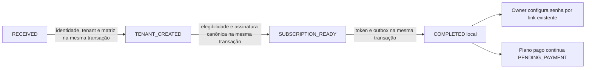

# ORB-NX-02 — Administração e provisionamento canônicos

Revisão local de 14/11/2026. Escopo exclusivo da ORB-NX-02; evidências verificáveis em [JSON](evidence/orb-nx-02-canonical-administration.json). Este documento não autoriza publicação nem declara o produto inteiro aprovado para produção.

## 1. Git inicial e final

- Branch: `feat/features-and-backlogs`.
- HEAD inicial: `deaba1ea1e008613296f506cb4de9f015414b64f`.
- Base inicial limpa. PR-00.C já registrada em `7e8fec077fd9fbbb1f80f31ed1ebe7a6137b6e77`; ORB-NX-01 já registrada no HEAD acima. Portanto, o bloqueador de base não consolidada não se aplica.
- Ao encerrar a validação técnica, o HEAD permanecia o mesmo e as alterações estavam no working tree, sem staging ou commit. Esse é o snapshot preservado nas evidências. Posteriormente, o responsável autorizou explicitamente o commit local da ORB-NX-02; este relatório acompanha esse commit, identificável no histórico Git. Nenhum push, merge, deploy ou teste em produção foi realizado.
- Os seis relatórios originais em `docs/integrations/nexus/` permanecem iguais aos blobs commitados. O manifesto de fontes no JSON delimita esta implementação.

## 2. Causa raiz

A criação administrativa chamava `RegistrationRepository` diretamente, passando campos financeiros de `Organization`, sem chamar o provisionamento de `OrganizationSubscription`. O cadastro público já passava pela assinatura canônica. Assim, criar pelo endpoint administrativo podia produzir um tenant aparentemente ativo no legado, sem contratação canônica equivalente.

O PATCH administrativo também resolvia `planKey` para `planId` e alterava plano, status de assinatura e fim do período diretamente na organização. As consultas e contagens administrativas consumiam esses mesmos campos. Havia duas fontes de verdade, sem registro durável das fases da criação nem recuperação segura de efeitos parciais.

Foram inspecionados os caminhos de registro, provisionamento, elegibilidade, comandos e projeção de assinatura, billing, guards e auditoria, além dos consumidores locais. A correção reutiliza o domínio existente; não estabelece outra máquina de estados financeiros.

## 3. Arquivos e contratos

| Grupo | Alterações |
| --- | --- |
| Administração | Controller, DTOs, service e repository em `backend/src/modules/platform-administration/`; nova `platform-subscription.projection.ts` e testes |
| Persistência | `backend/prisma/schema.prisma`, migration `20261114220000_orbnx02_canonical_administration`, `backend/src/scripts/provision-database-roles.ts` |
| Reuso transacional | `identity/infrastructure/registration.repository.ts`, `identity/infrastructure/identity.repository.ts`, `subscription-plans/subscriptions/{subscription-provisioning.service,subscription.repository,trial-eligibility.service}.ts` |
| Diagnóstico | `backend/scripts/audit-administrative-subscriptions.sql` |
| Verificação | `backend/test/platform-canonical-administration.e2e-spec.ts`, specs de administração/projeção e `frontend/src/server/bff/allowlist.test.ts` |

Todos os caminhos HTTP abaixo têm prefixo `/api/v1`. Permanecem protegidos por autenticação, papel global e permissão provenientes da autoridade verificada da ORB-NX-01. O service também valida essa proveniência; uma string de papel não é suficiente.

| Contrato | Comportamento |
| --- | --- |
| `POST /platform-admin/tenants` | `owner.password` opcional e depreciado; `billingInterval` padrão `MONTHLY`; plano deve existir no catálogo comercial e estar disponível no registro inicial. `Idempotency-Key` recomendado, ASCII de 1–128 caracteres. Retorna a organização e `provisioning`; `201` significa fases locais completas, **não** pagamento, entrega de e-mail ou aceite do owner. `202` significa fase local pendente. |
| `GET /platform-admin/tenant-provisionings/:id` | Consulta a operação e seus efeitos persistidos. Sem tenant criado, informa `RESUBMIT_ORIGINAL_REQUEST`; não expõe senha, token, hash ou payload original. |
| `POST /platform-admin/tenant-provisionings/:id/resume` | Retoma fases posteriores à criação do tenant. `200` quando localmente completa; `202` enquanto pendente. Não gera outro convite em operações completas. |
| `PATCH /platform-admin/organizations/:id` | Permite `displayName` e `primarySegment`, exigindo `expectedUpdatedAt` obtido na leitura. Versão desatualizada: `409`; campo financeiro ou mudança de status operacional: `400`. Status idêntico pode ser enviado como no-op. |
| GETs administrativos existentes | Mantêm os caminhos e passam a projetar assinatura canônica. Acrescentam `subscription`, `legacyBilling` e `provisioning`; sem assinatura canônica, plano efetivo fica `null` e status `UNKNOWN`. |

Exemplo de alteração cadastral: `{ "displayName": "Empresa Atualizada", "expectedUpdatedAt": "<updatedAt recebido na consulta>" }`. `expectedUpdatedAt` deve conter uma data ISO real, não o texto ilustrativo.

## 4. Modelo, migration e acesso ao banco

`PlatformTenantProvisioning` registra operador, fingerprints de chave/payload, correlação original, plano e intervalo solicitados, fase, referências aos efeitos, erro categorizado, tentativas de falha, versão e timestamps. Não armazena o corpo original nem senha/token em claro.

Fases permitidas por CHECK: `RECEIVED`, `TENANT_CREATED`, `SUBSCRIPTION_READY`, `COMPLETED`. Há unicidade `(actor_user_id, idempotency_key)` e por organização; índices suportam diagnóstico por fase/data. Os vínculos com operador, owner, organização e token de setup têm FKs. A unidade inicial é identificada por UUID e conferida com organização, condição de matriz e exclusão lógica ao retomar.

A tabela tem RLS habilitado e forçado, com política restrita a `app_is_platform_admin()`. O papel de runtime recebe SELECT/INSERT/UPDATE; o bootstrap de permissões também revoga DELETE, evitando que seu grant geral o reintroduza. Testes executam a aplicação como `orbit_app`, sem SUPERUSER/BYPASSRLS, e confirmam invisibilidade da tabela para um owner.

A migration apenas adiciona estrutura. Não altera assinaturas antigas, não atribui grants, não saneia organizações e não reescreve períodos ou preços. Aplicada somente ao PostgreSQL descartável dos testes. A aplicação dessa migration em um ambiente compartilhado dependerá de uma release posterior autorizada.

## 5. Novo fluxo

1. Valida autoridade real, intenção e campos permitidos; registra a operação e auditoria.
2. Reutiliza `RegistrationRepository` numa transação local para criar usuário, credencial, organização, matriz, papéis e memberships. Reutiliza a reserva de documento do cadastro público. No fluxo sem senha fornecida, gera segredo aleatório e salva somente seu hash; esse segredo não é devolvido nem enviado ao owner.
3. `SubscriptionProvisioningService.provisionIn` chama os mesmos serviços canônicos de assinatura e elegibilidade. O Essencial só recebe os 30 dias quando elegível; recusa de elegibilidade produz `PENDING_PAYMENT`. Erro de infraestrutura permanece pendente, sem ser interpretado como simples recusa de trial. Plano pago começa em `PENDING_PAYMENT`, sem liberar operação antes da confirmação do fluxo existente.
4. Sem senha fornecida, reutiliza o token opaco de recuperação e a outbox criptografada de identidade. Expiração de 30 minutos; owner usa a página existente de redefinição. Com senha legada, mantém o e-mail de boas-vindas/verificação existente. Persistir a outbox não significa entrega SES.
5. Expõe separadamente fase local, estado de setup e assinatura. `COMPLETED` não significa que o owner aceitou convite, assinou contrato ou pagou. `deliveryConfirmation` permanece `NOT_OBSERVED` nesta projeção.

Não há chamada Stripe ou SES dentro dessas transações nem compensação financeira local. Checkout, confirmação de pagamento, cancelamento, mudança agendada e retenção continuam nos serviços existentes. Não é fabricado consentimento: nenhuma aceitação de termos é inserida em nome do owner. O onboarding jurídico público não foi modificado; este setup administrativo não deve ser apresentado como prova de consentimento.

## 6. Campos legados e projeções

Na criação, `subscriptionStatus`, `currentPeriodEnd`, `externalCustomerId` e `externalSubscriptionId` são documentados como somente leitura/depreciados; enviá-los é rejeitado, em vez de conceder direitos. `organizationStatus` aceita apenas `ACTIVE`/`ONBOARDING` neste fluxo. No PATCH, `planKey`, `subscriptionStatus` e `currentPeriodEnd` também são rejeitados; alterações de `status` operacional ficam fechadas, sem antecipar ORB-NX-03.

Mudança de plano e cancelamento devem seguir os comandos de billing já existentes, incluindo consentimento, pagamento ou efeito agendado no vencimento. Esta PR não acrescenta comando financeiro administrativo remoto.

As consultas usam `subscription.projection` e `grantsProductAccess` existentes, observando relógio, término e mudanças pendentes. Selecionam contratação corrente; se não houver, usam a última histórica apenas para representar encerramento. Cancelamento/mudança agendados são expostos enquanto pertinentes, não após um estado terminal. O overview distingue tenants cadastrados, assinaturas ativas, pendentes, trials válidos, encerradas, mudanças/cancelamentos agendados e ausência de fonte canônica. Não calcula receita a partir do legado nem mistura valores HVAC com assinatura SaaS.

`legacyBilling` mantém os dados antigos para diagnóstico, com sinal de divergência; não é fonte de acesso. Ausência de contratação canônica resulta em `UNKNOWN_LEGACY`/`UNKNOWN`, sem concessão presumida. Os campos físicos de `Organization` não são sincronizados por esta PR.

O script SQL de diagnóstico abre uma transação **READ ONLY** e compara estados armazenados. Ele precisa de conexão de leitura legitimamente autorizada; não contorna RLS. Diferença entre estados armazenados não equivale, sozinha, a defeito de cobrança ou autorização efetiva. Proposta de correção histórica: inventariar divergências por ID, confrontar contrato/fatos canônicos e registros de pagamento, submeter cada classe de correção à aprovação e executar eventual saneamento em PR própria. Não converter legado ACTIVE em pagamento confirmado, conceder novo trial ou reabrir período por inferência.

## 7. Idempotência, recuperação e auditoria

- A chave é escopada ao operador e persistida por hash; o payload normalizado tem fingerprint independente. Mesmo operador/chave e mesmo payload observam a operação original. Mesmo operador/chave e outro payload resultam em `409`.
- Para clientes antigos sem header, a chave estável deriva de e-mail/documento normalizados. A variante com senha usa HMAC para o fingerprint desse campo. Para novos consumidores, enviar uma chave explícita estável durante todos os retries.
- Cada fase adquire advisory lock transacional PostgreSQL por operação. A fase e seus efeitos são commitados juntos; concorrentes observam a fase já persistida. Constraints de identidade/documento/assinatura/trial continuam protegendo efeitos entre operações distintas.
- Falha inicial não deixa owner/tenant órfãos; o registro `RECEIVED` permanece para repetição do POST original. O corpo não é guardado, portanto essa fase não pode ser reconstruída somente pelo ID. Falhas posteriores são retomadas por ID, sem recriar tenant, trial ou contratação.
- Falha na inclusão do setup/outbox não remove tenant nem assinatura. Uma mensagem já enfileirada não é reenviada pelo resume de operação completa. Entrega e retry continuam sob responsabilidade da outbox existente. Link expirado usa o fluxo existente de recuperação de senha; não um novo provisionamento.
- Leituras e mutações administrativas bem-sucedidas, recusas do service e fases pendentes relevantes têm auditoria com operador real, origem/grants de autoridade, intenção, correlação e resultado. Transições confirmadas incluem antes/depois. Erros de validação anteriores ao service seguem os logs HTTP existentes; não há promessa de audit row para todo request inválido.
- A versão da operação cresce nas transições/falhas. Alteração cadastral usa CAS sobre `updatedAt`, sem escrever campos financeiros. A chave original conserva sua correlação; cada auditoria também registra o request que efetuou aquela etapa.

## 8. Verificações e resultados

| Gate local | Resultado |
| --- | --- |
| Unitários backend direcionados | 10 suítes, 64 testes aprovados |
| HTTP/PostgreSQL/RLS consolidado | 7 suítes, 126 testes aprovados |
| Reexecução da suíte nova com recuperação de senha posterior | 1 suíte, 15 testes aprovados; subconjunto dos 126, não somar novamente |
| Compatibilidade BFF/auth/signup web | 4 arquivos, 51 testes aprovados |
| Backend typecheck e build | Aprovados |
| ESLint direcionado backend e teste BFF | Aprovados |
| `contracts:guard` | Aprovado |
| `lint:public-errors` | Aprovado; 72 códigos, sem matching de mensagens do backend na web/mobile |

A suíte nova cobre 15 casos, incluindo plano pago, trial elegível e já consumido, três fases de falha injetada, retomada, três chamadas concorrentes com mesma chave, conflito de payload, cliente legado, PATCH financeiro, CAS, projeções divergentes e autoridade/RLS/auditoria. O cenário de owner também verifica setup real pelo endpoint de reset, token de uso único, login, operação bloqueada por pagamento e recusa de endpoints administrativos. A reexecução adicional confirmou que uma nova solicitação de recuperação de senha funciona após o setup, sem conflito com a FK da operação; o endpoint existente responde `202 Accepted`.

Os testes integrados aplicaram as 117 migrations em banco novo descartável e provisionaram permissões para 143 tabelas. A aplicação usou runtime restrito; acesso privilegiado foi usado somente para preparar/inspecionar/remover fixtures. As regressões consolidadas incluem ORB-NX-01, outbox de e-mail, assinaturas, expiração, billing Stripe simulado e RLS. Nenhuma cobrança, entrega de e-mail ou operação Stripe live foi feita. Comandos exatos e manifestos ficam no JSON; logs em `/private/tmp` são locais e temporários.

## 9. Compatibilidade web/mobile

A inspeção local encontrou o BFF genérico, que já permite `/platform-admin` com sessão e encaminha `Idempotency-Key`; não encontrou formulário web nem fluxo mobile chamando a criação/PATCH administrativos. Os testes adicionados confirmam acesso autenticado aos contratos de criação, consulta e retomada pelo allowlist. Os contratos públicos de identidade/sessão/token não foram alterados. O cadastro público, trial, autenticação e outbox têm regressões aprovadas.

Compatibilidade mantida: caminho antigo de criação, senha fornecida opcional e ausência de header. Limitação deliberada: consumidores externos desconhecidos que enviem campos financeiros precisam removê-los; custom plans fora do catálogo comercial não são provisionados por esta rota. Leituras sem fonte canônica agora retornam plano efetivo nulo/status desconhecido. Atualizações cadastrais precisam obter e enviar `updatedAt`. É uma transição explícita para falhar de forma segura, não compatibilidade irrestrita com o comportamento financeiro inseguro antigo.

Não foram alteradas telas web/mobile nem executados build nativo ou testes visuais. O build completo Next.js não foi repetido: a única alteração web é um teste do BFF, validado com Vitest e ESLint.

## 10. Riscos residuais e pendências

- A validação local usou Node `v25.1.0`; o projeto de CI/Docker usa Node 22. É necessário executar o CI da branch no runtime suportado antes de publicar.
- Entrega real SES, configuração de domínio e comportamento Stripe live/sandbox externa não foram qualificados nesta tarefa. Não há afirmação de e-mail entregue a partir de outbox persistida.
- A leitura global permanece uma leitura administrativa interna ampla. Overview percorre organizações em lotes de 200; não houve teste de carga ou consistência de snapshot global sob alto volume. Exportação corporativa minimizada fica nas PRs futuras.
- A revisão não é execução da suíte completa do monorepo. As evidências cobrem o escopo e regressões especificadas.
- Dados históricos continuam intactos; diagnóstico e aprovação precedem qualquer reparo. Backfill, política efetiva de suspensão e sweep/replay Stripe permanecem fora desta PR.
- O setup administrativo não representa aceitação jurídica, entrega confirmada nem concessão de acesso. Produtos futuros devem preservar essas distinções.
- Não há Nexus, M2M, SSO, painel corporativo, novos preços, refunds ou exclusão remota implementados.

## 11. Parecer técnico

Gate técnico local da ORB-NX-02 aprovado, com as limitações registradas acima e os resultados no JSON. A implementação remove o caminho administrativo de concessão financeira pelo legado, usa assinatura/trial canônicos e persiste recuperação transacional, mantendo a proveniência de autoridade da ORB-NX-01. O commit local foi autorizado pelo responsável após a validação. Isso não aprova rollout nem substitui CI, revisão do diff e autorização de release. ORB-NX-03 não foi iniciada.
